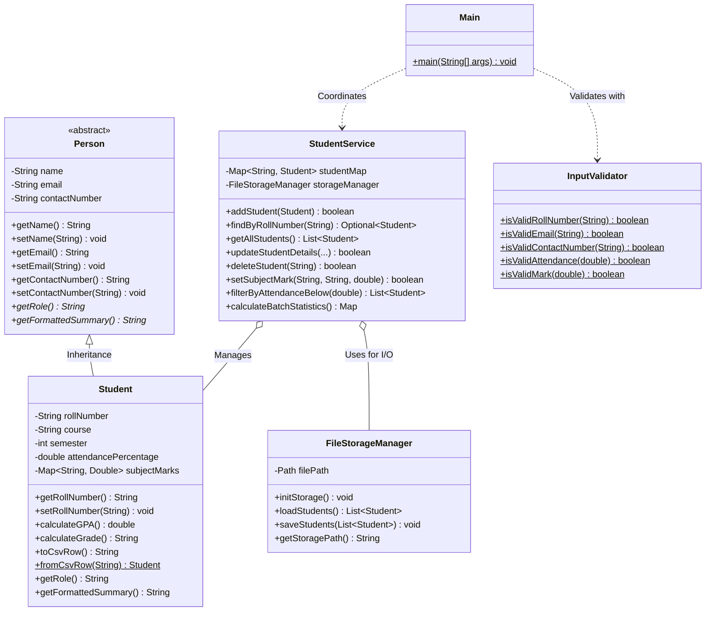

# Student Management System

An interactive, console-based academic management application architected strictly adhering to Object-Oriented Programming (OOP) principles and robust persistent File I/O in Java.

Built by **Vishanth R** (B.Tech in Computer Science & Engineering - AI & Data Engineering, Jain University).

---

## 🎯 Alignment with Resume Highlights

| Resume Specification | Implementation Detail |
| :--- | :--- |
| **Adhering to OOP Principles** | • **Abstraction:** Abstract class `Person` defining fundamental identity attributes and abstract contract methods (`getRole()`, `getFormattedSummary()`).<br>• **Inheritance:** Concrete class `Student` extends `Person`, inheriting fields and polymorphic methods.<br>• **Encapsulation:** Private properties accessed strictly via validated getters and setters.<br>• **Polymorphism:** Runtime dynamic method dispatch for grade computation and summary formatting. |
| **Full CRUD Operations** | • Create: Guided prompts for entering student demographic & academic info with real-time validation.<br>• Read: Tabular batch summaries & detailed individual student report cards.<br>• Update: Selective attribute modifications and subject mark management.<br>• Delete: Safe roll number-based record removal with confirmation safeguards. |
| **Search by Roll Number** | Fast in-memory hash-indexed lookups with case-insensitive roll number query support. |
| **Persistent File Handling** | Atomic CSV serialization/deserialization to `data/students.csv`, automatic initial seed data generation, and automatic data persistence across application restarts. |

---

## 🏗️ Architecture & OOP Design



---

## 📁 Directory Structure

```
02-student-management-system/
├── bin/                             # Compiled bytecode (.class files)
├── data/
│   └── students.csv                 # Persistent CSV storage file
├── src/
│   └── com/vishanth/sms/
│       ├── Main.java                # Interactive CLI application entry point
│       ├── model/
│       │   ├── Person.java          # Abstract base entity
│       │   └── Student.java         # Inherited concrete student model
│       ├── service/
│       │   └── StudentService.java  # Business logic, CRUD, filtering & analytics
│       ├── util/
│       │   ├── FileStorageManager.java # CSV File I/O and atomic persistence
│       │   └── InputValidator.java     # Regex and boundary input validation
│       └── test/
│           └── StudentSystemTest.java  # Automated test suite (33 assertions)
├── compile.bat                      # Windows build script
├── run.bat                          # Windows execution script
├── run_tests.bat                    # Automated test runner script
└── README.md                        # Documentation
```

---

## 🚀 Getting Started

### Prerequisites
- Java Development Kit (JDK 11 or higher - tested on OpenJDK 17)

### 1. Compile the Source Code
```cmd
compile.bat
```
*(Or manually: `javac -encoding UTF-8 -d bin src\com\vishanth\sms\model\*.java src\com\vishanth\sms\util\*.java src\com\vishanth\sms\service\*.java src\com\vishanth\sms\*.java src\com\vishanth\sms\test\*.java`)*

### 2. Run the Application
```cmd
run.bat
```
*(Or manually: `java -cp bin com.vishanth.sms.Main`)*

### 3. Run Automated Tests
```cmd
run_tests.bat
```
*(Or manually: `java -cp bin com.vishanth.sms.test.StudentSystemTest`)*

---

## 📊 Sample Execution Screenshots / CLI Output

```text
==========================================================================================================
Roll No      | Student Name         | Course                   | Sem  | GPA    | Grade            | Attendance
-------------+----------------------+--------------------------+------+--------+------------------+-----------
25JUCS001    | Vishanth R           | B.Tech CSE (AI & DE)     | 2    | 8.72   | A+ (Excellent)   | 88.5     %
25JUCS002    | Aarav Sharma         | B.Tech CSE (AI & DE)     | 2    | 8.96   | A+ (Excellent)   | 91.0     %
25JUCS003    | Priya Nair           | B.Tech CSE (AI & DE)     | 2    | 7.22   | A (Very Good)    | 72.0     %
25JUCS004    | Rohan Verma          | B.Tech CSE (Data Scie... | 2    | 6.00   | B+ (Good)        | 65.5     %
25JUCS005    | Ananya Iyer          | B.Tech CSE (AI & DE)     | 2    | 9.50   | O (Outstanding)  | 95.0     %
==========================================================================================================
```
